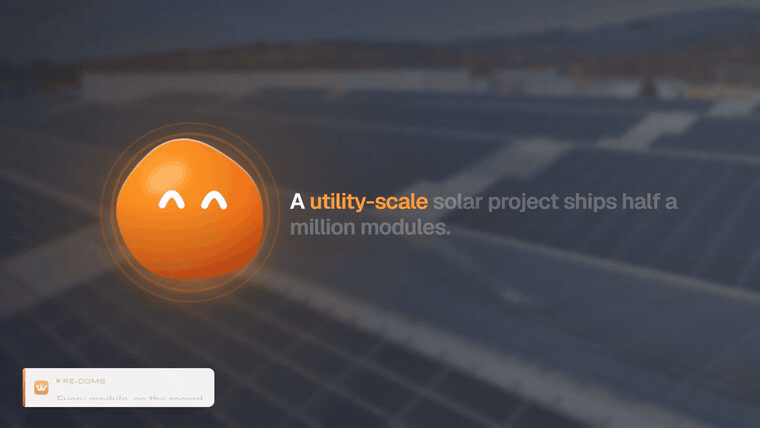
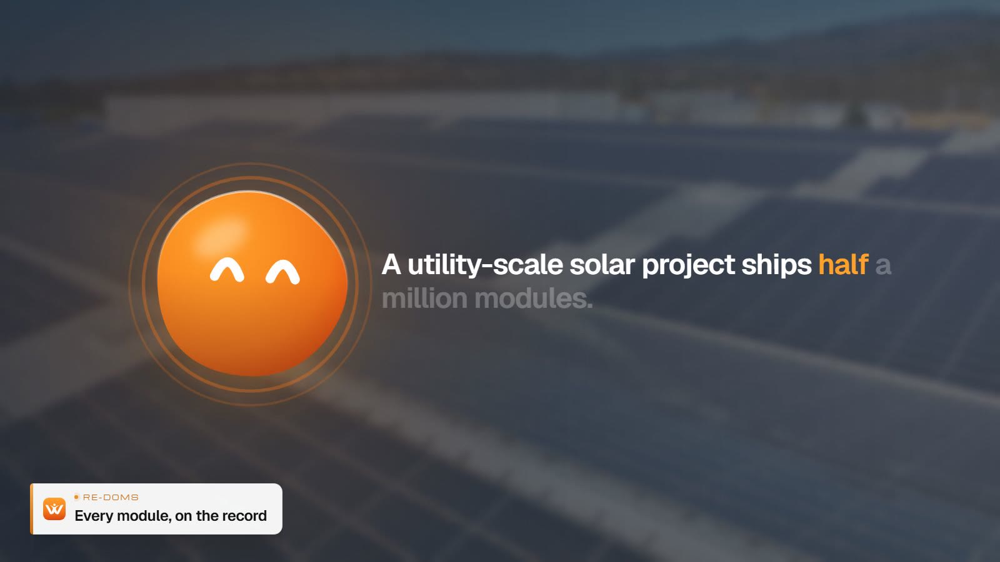
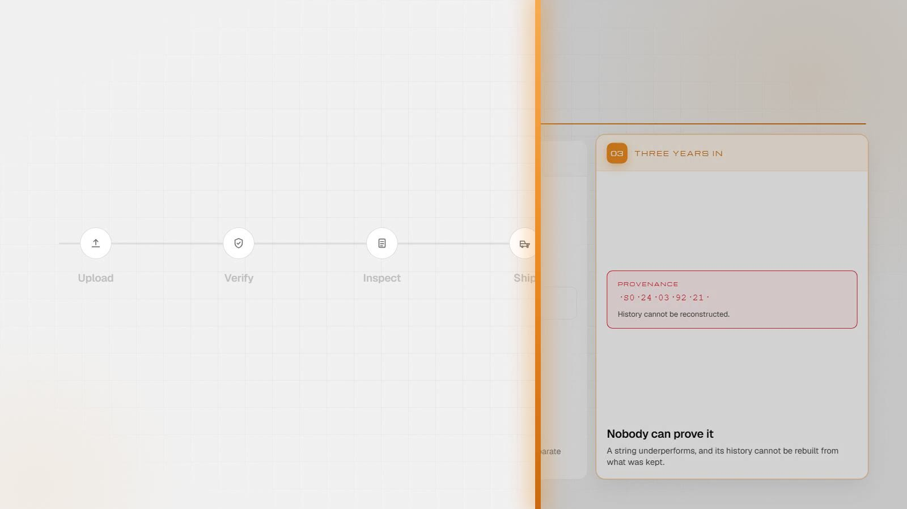
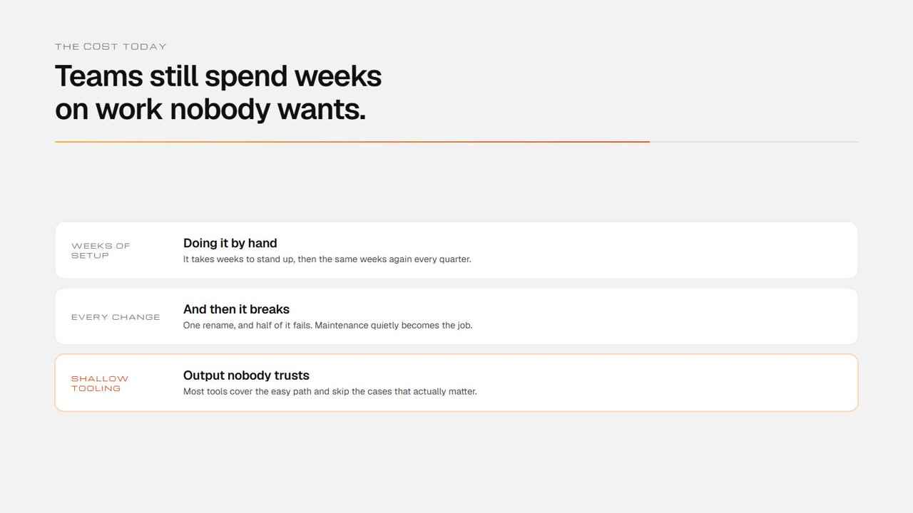
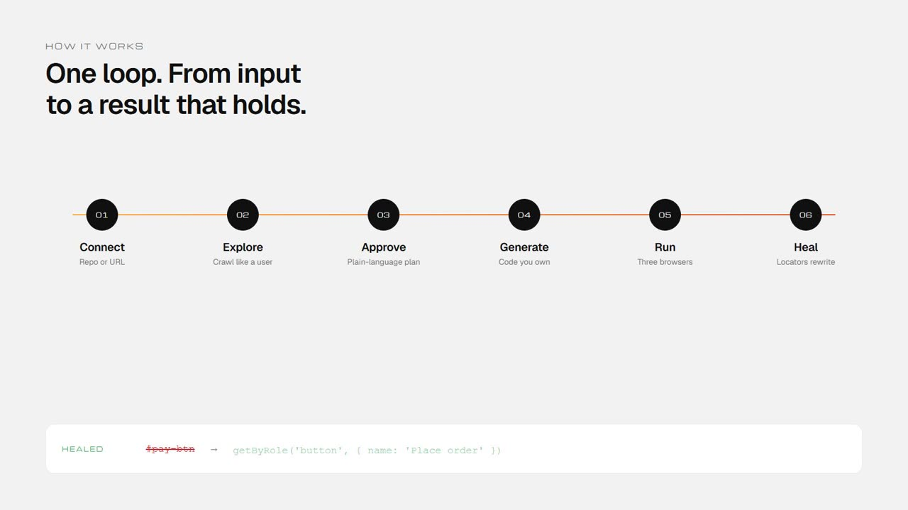
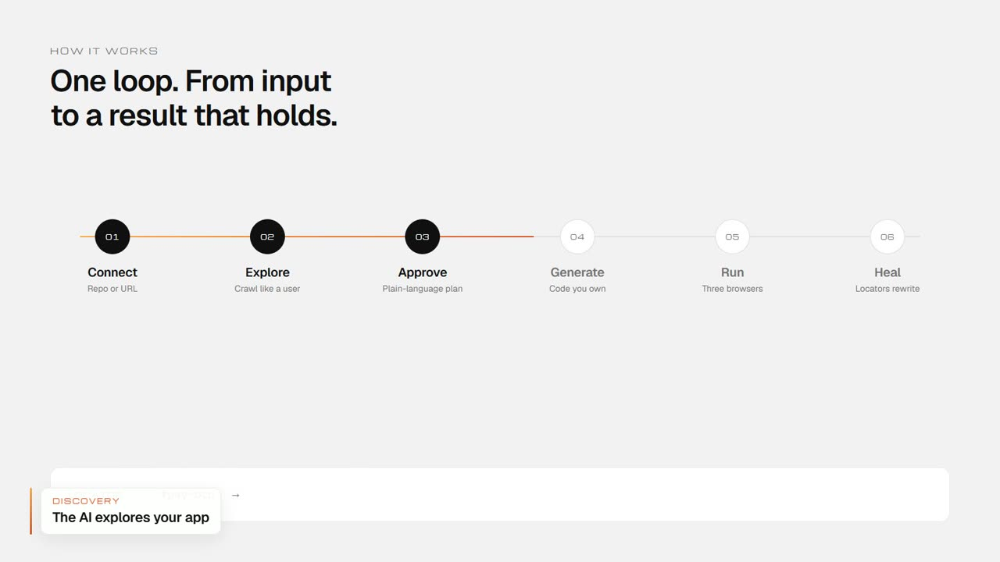
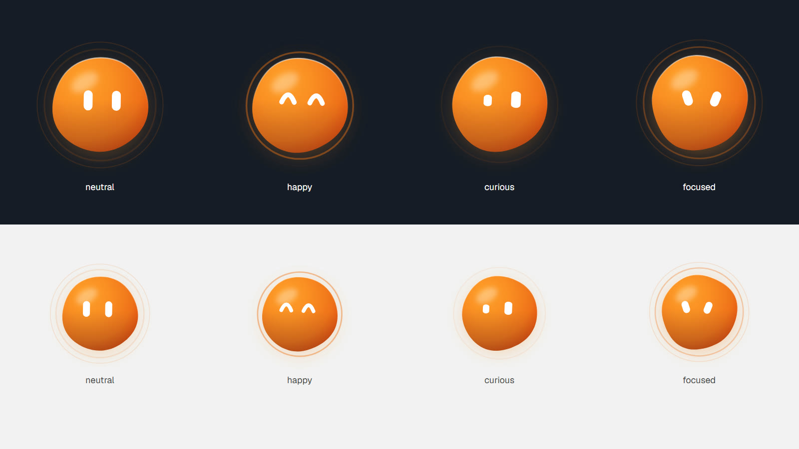
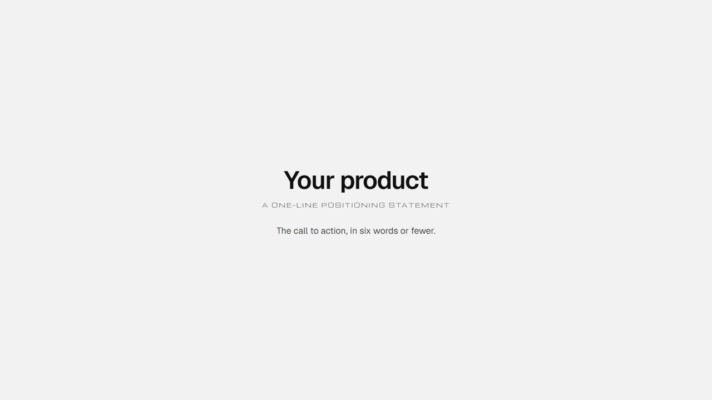
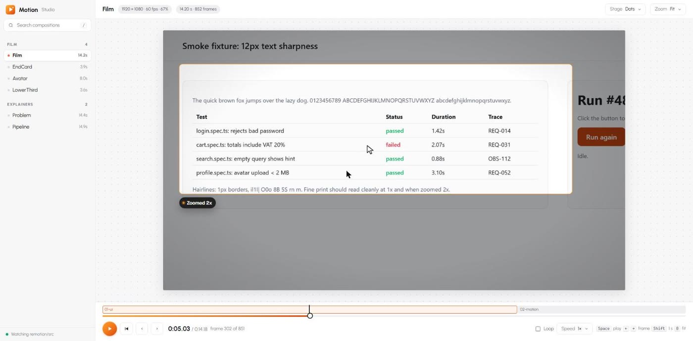
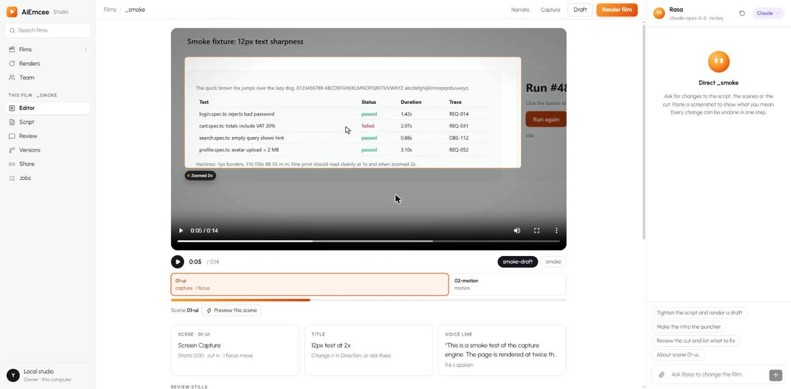

<div align="center">

# AiEmcee

**Narrated product demo videos, generated end to end from a text file.**

Write the script. AiEmcee records your product, voices the narration, animates
the explainers, directs the camera, scores it, and cuts the film.
No editor, no timeline, no manual sync.

[](https://github.com/mrigankad/AiEmcee/actions/workflows/ci.yml)
[](https://github.com/mrigankad/AiEmcee/releases)
[](https://nodejs.org)
[](LICENSE)
[](docs/14-motion-engine.md)



<sub>An excerpt from a real film built with this repo. No frame was edited by hand.</sub>

[Capabilities](#capabilities) · [Quickstart](#quickstart) · [How it works](#how-it-works) · [The studio](#the-studio) · [Motion engine](#the-motion-engine) · [Commands](#commands) · [Docs](#documentation)

</div>

---

## What you get

<table>
<tr>
<td width="50%" valign="top">

**Your real product, on camera.** Playwright drives your app with a virtual
cursor that eases and clicks like a person, or AiEmcee cuts scenes out of a
recording you already have.

</td>
<td width="50%" valign="top">

**Designed explainers** for the parts that are an argument, not a UI:
headlines that set word by word, claims that land one at a time.

</td>
</tr>
<tr>
<td valign="top">



**An AI presenter** that speaks the narration, moving with the voice, and
shows it as word-by-word captions. It hosts the opening and the close, then
presents the product from the corner.

</td>
<td valign="top">



**A directed edit.** Transitions between every scene, and camera moves that
zoom in on the part of the UI that matters, dim the rest and name it.

</td>
</tr>
</table>

And the finishing touches, all automatic:

- **A directed voice.** Free neural TTS, spoken a sentence at a time with
  pace and pitch set by what each line is for (`hook`, `problem`, `feature`,
  `payoff`…), with deliberate pauses and a mastering chain.
- **Sound design.** A music bed that ducks under the voice, effects cued from
  the edit, and the master levelled to -16 LUFS for every platform.
- **Five tones**: `polished`, `default`, `cinematic`, `app-store`,
  `deadpan`. One setting changes transitions, camera, grade, motion and sound
  together.
- **Ready to post.** The best frame is baked in as the thumbnail, and a
  contact sheet of every scene, transition and title is written for review.
- **A studio for the team.** Direct a film in chat with Rasa, preview one
  scene in two seconds, review with comments pinned to frames, approve, and
  share a link with chapters, captions and a lead form.

<table>
<tr>
<td width="33%" valign="top">



**Explainers** set the argument word by word.

</td>
<td width="33%" valign="top">



**Diagrams** that build step by step, timed to the voice.

</td>
<td width="33%" valign="top">



**Titles** that name each scene as it starts.

</td>
</tr>
<tr>
<td valign="top">



**Moods** for the presenter, set per scene.

</td>
<td valign="top">



**An end card** with your mark and the call to action.

</td>
<td valign="top">



**Motion Studio** to preview any scene, frame by frame.

</td>
</tr>
</table>

---

## Capabilities

Everything in AiEmcee is built here: the timeline, the voice direction, the
capture pipeline, the renderer and the studio.

| Area | What it does |
| --- | --- |
| **Script** | One JSON file, one line per scene. Each line carries a delivery (`hook`, `problem`, `feature`, `payoff`…) and inline pauses (`[beat]`). |
| **Voice** | Neural TTS spoken a sentence at a time, sentences in parallel; pace and pitch per delivery; a mastering chain. Line lengths become the film's clock. |
| **Capture** | Playwright drives your real app with an eased, human cursor at 2x (3840×2160) into a lossless 60 fps intermediate. Or cut scenes from a recording you already have. |
| **Direction** | Five tones; transitions between every scene; focus moves that zoom, dim and label part of the UI; a presenter with moods and captions; a music bed and cued effects levelled to -16 LUFS. |
| **Motion engine** | AiEmcee Motion: the scenes are React; frames are drawn in headless Chromium, footage is decoded at the size each frame shows, and the film renders in cached, parallel chunks. 8× faster than the engine it replaced. |
| **Profiles** | Master (PNG, crf 12), fast (JPEG, veryfast), draft (720p), a one-scene preview in about two seconds, and a 4K master. |
| **Review** | A poster frame, a contact sheet of every scene, transition and title, and frame-accurate drift checks on every build. |
| **Studio** | A web app for the team: films, a scene editor, script, review with pinned comments and approvals, versions with diff and undo, share links with analytics and lead capture, renders and roles. |
| **Rasa** | A director in chat that edits the project and renders the change, with Claude, OpenAI or Grok. Paste a screenshot to show what you mean; undo any turn. |
| **Agents** | `/emcee`, a Claude Code skill that directs a film end to end, and prompts for every stage. |
| **Scale** | `batch` renders many films and skips the ones already up to date. |

---

## Quickstart

You need Node 20+, [ffmpeg](https://ffmpeg.org/download.html) and
`pip install edge-tts`. Your app should be running in production mode on the
URL in the project's `video.config.mjs`; a dev server can flash an error
overlay into the footage at any moment.

### Many films, one engine (this repo)

Each film is a folder of data under `projects/`. The scripts, the scenes
(`remotion/src`), the motion engine and the shared assets at the repo root are
the engine.

```bash
npm run setup                                   # once: pinned deps + Chromium
cp -r projects/_template projects/my-film       # then edit its files
npm run doctor -- --project projects/my-film    # toolchain + project check
npm run film   -- --project projects/my-film    # narrate → clip → capture → compose
```

A project needs only `video.config.mjs`, `narration.json`, `scenes.mjs`,
optional `design.tokens.json`, `assets/` and `PROMPTS.md`; `tts/ raw/ work/
out/` are generated and git-ignored. Footage is captured at 2x (3840x2160) and
the film renders at 1080p60: see **[docs/11-quality.md](docs/11-quality.md)**.

The older layout, one film at the repo root (`video.config.mjs` there), still
builds when you leave out `--project`.

### A standalone project

```bash
npx @mrigankad/aiemcee init my-video
cd my-video
npm run setup      # node deps, the scenes' deps, Chromium
npm run doctor     # checks ffmpeg, edge-tts and the rest, with a fix for anything missing
npm run build      # narrate → clip → capture → compose  →  out/demo.mp4
```

<details>
<summary>The package is on GitHub Packages, which needs one line of npm config</summary>

<br>

```bash
echo "@mrigankad:registry=https://npm.pkg.github.com" >> ~/.npmrc
npm login --scope=@mrigankad --registry=https://npm.pkg.github.com
```

Or skip the registry and clone:
`git clone https://github.com/mrigankad/AiEmcee.git my-video`.

</details>

Full walkthrough: **[docs/01-quickstart.md](docs/01-quickstart.md)**.

---

## How it works

**Audio is the metronome.** Normal video work records the picture, then fights
to fit a voice to it. AiEmcee does it the other way round:

1. Every narration line is spoken first, and its exact length measured.
2. Every scene gets exactly *that line + a short gap*, on one timeline.
3. The picture (one composition, drawn by AiEmcee Motion) and the sound (one
   ffmpeg mix) are both built from that timeline. So are the transitions,
   titles, camera moves, the presenter's captions and every sound effect.

Two tracks cut from one set of numbers can't drift. Every build proves it:

```
video    112.37s
audio    112.38s
drift    0.008s
```

```
narration.json ──▶ directed voice ──▶ line lengths
                                          │
  your app / a recording ──▶ footage      ▼
                                 ──▶  timeline  ──▶  Motion picture ───┐
  explainers, titles, avatar ─────────────┘     └─▶  ffmpeg sound ────┴─▶ out/demo.mp4
```

The video is a build artifact. When the product changes, run the build again:
the picture is cached in chunks, so only the scenes that changed are redrawn.

More: **[docs/02-architecture.md](docs/02-architecture.md)**.

---

## What you edit

Four files. Everything else is machinery.

| File | Holds |
| --- | --- |
| `narration.json` | the script, one line per scene, and how each line is said |
| `video.config.mjs` | running order, tone, voice, camera moves, avatar, sound |
| `scenes.mjs` | what the browser does in each recorded scene |
| `design.tokens.json` | colours, fonts, frame size, shared by the pipeline and the scenes |

A line of script:

```json
{
  "id": "04-search",
  "delivery": "feature",
  "text": "Type any serial number, and its whole history comes back. [beat] One search."
}
```

A scene in the running order, with a camera move and the presenter:

```js
{
  id: "04-search",
  from: "capture",
  lowerThird: { kicker: "Search", title: "Any record, its whole history" },
  focus: [{ at: 4.8, until: 7.7, box: [0.36, 0.34, 0.3, 0.34], label: "The record, from the line" }],
  avatar: { mode: "corner", mood: "curious" },
}
```

`focus` times are seconds into the footage, and `box` is a region of the frame
(`[x, y, w, h]`, as fractions). Everything else in the direction toolkit is in
**[docs/10-direction.md](docs/10-direction.md)**.

---

## The studio

Everything above works from the terminal. **AiEmcee Studio** puts it in a
browser, for you and your team.

```bash
npm run web                     # the studio server, http://127.0.0.1:4810
npm --prefix web install        # once
npm --prefix web run dev        # the studio app, http://localhost:3000
```

The server runs the engine (renders, files, versions, chat) and the app, built
with Next.js in `web/`, talks to it. Set `AIEMCEE_STUDIO_URL` if the server is
somewhere else.



| Screen | Does |
| --- | --- |
| **Films** | every project with its poster, length and status; filter and sort |
| **Editor** | the player, the scene strip, and **Preview this scene**: one scene and its sound, drafted in about two seconds |
| **Script** | one card per line, with word counts and spoken lengths; save and narrate |
| **Review** | comments pinned to the playhead, replies, resolve, *Fix with Rasa*; approve a film or request changes |
| **Versions** | every edit, Rasa turn and render saves one; diff against now, restore, undo |
| **Share** | a public link with chapters, captions, a call to action and a lead form; views, average watch and how far viewers got, per scene |
| **Renders** | the job queue and live logs; cancel |
| **Team** | people and roles: viewer, approver, editor, owner |

**Rasa**, the director, is a chat panel on every film. It reads and edits the
project's files, runs the stage that shows the change, and takes screenshots
you paste in. Every turn can be undone in one step. Pick the model in the
panel; each needs its key in the server's environment:

| Model | Key |
| --- | --- |
| Claude | `ANTHROPIC_API_KEY` (model: `AIEMCEE_CLAUDE_MODEL`) |
| OpenAI / Codex | `OPENAI_API_KEY` (model: `AIEMCEE_OPENAI_MODEL`) |
| Grok | `XAI_API_KEY` (model: `AIEMCEE_XAI_MODEL`) |

**Working as a team.** The studio listens on this computer only until it has
users. Add the first owner, then open it up:

```bash
node bin/aiemcee.mjs studio user add you@example.com owner   # prints a token, once
node bin/aiemcee.mjs studio --host 0.0.0.0                   # put HTTPS in front
```

Each person signs in with their own token. Once there are users, a film can be
shared only after an approver has approved it. Leads from share pages are kept
with the project and, with `AIEMCEE_LEADS_WEBHOOK` set, posted to your CRM.
Plan, API and security notes: **[docs/13-backend.md](docs/13-backend.md)**.

---

## The motion engine

AiEmcee draws its pictures with its own engine, **AiEmcee Motion**: a small
runtime for the scenes, an esbuild bundle, headless Chromium pages that capture
each frame, and a frame server that decodes footage at the size each frame
shows. It replaced Remotion on 2026-11-12; the scenes did not change.

| Smoke film, 14 s at 1080p60 | Remotion | Motion |
| --- | --- | --- |
| `compose --fast` render | 260.6 s | 31.8 s |
| bundle | 13 s | 0.3 s |
| a cached re-render | | 0.6 s |
| scene dependencies | 980 MB | 49 MB |

Frames match the old engine (SSIM 0.995), and its spring, easing and
interpolation maths match Remotion 4.0.518 bit for bit
(`npm --prefix remotion test`).

**Motion Studio** previews the scenes while you write them:

```bash
npm run studio -- --project projects/my-film    # http://127.0.0.1:3123
```

Every composition, searchable and grouped; scrub, play, step frame by frame,
zoom, loop, change speed. It rebuilds when you save a scene. The Film shows
the project's last compose, with its scenes on the timeline.

More: **[docs/14-motion-engine.md](docs/14-motion-engine.md)**.

---

## Let Claude direct it

The repo is built to be handed to an agent: the script, the choreography and
the motion graphics are all text. It ships with a Claude Code skill,
**`/emcee`**, that directs a film end to end. It reads your footage on a
grid, places camera moves on the real UI, picks the tone and the presenter's
moods, builds, reviews every still and fixes what's wrong.

```
/emcee make it feel like a launch
```

One rule makes or breaks it: **Claude can't see your product.** Point it at
the product's repo, or paste the routes and selectors. Prompts for every
stage: **[docs/prompts/](docs/prompts/)** · the reasoning:
**[docs/08-prompting-claude.md](docs/08-prompting-claude.md)**. In the studio,
the same work happens in the Rasa panel.

---

## Commands

| Command | Does |
| --- | --- |
| `npm run film -- --project <dir>` | narrate → clip → capture → compose for one project |
| `npm run build` | the same, for the root film |
| `npm run narrate` | speaks the script → `tts/`. `-- --audition` compares voices |
| `npm run capture` | records your app → `raw/*.mp4` (HQ screencast, 3840x2160 → lossless 60 fps); `raw/*.webm` with `capture.mode: "recordVideo"` |
| `npm run clip` | cuts scenes from an existing recording → `raw/*.mp4` |
| `npm run compose` | renders and mixes the film → `out/`, plus poster and review stills. `-- --sound-only` remixes in seconds |
| `npm run motion` | renders the project's motion scenes on their own → `remotion/out/` |
| `node bin/aiemcee.mjs batch --projects "projects/uc-*" --fast` | composes many films, skipping up-to-date ones |
| `npm run validate` | checks the config, no external tools needed |
| `npm run doctor` | checks the toolchain |
| `npm run studio` | Motion Studio: preview every composition, rebuilt on save |
| `npm run web` | the AiEmcee Studio server (pair it with `npm --prefix web run dev`) |

Every command takes `--project <dir>`. Most steps take a scene id, so you can
work on one thing at a time: `npm run capture -- --project projects/my-film --only 04-search`.

### Compose: master, fast, draft, preview

```bash
node bin/aiemcee.mjs compose --project projects/my-film                    # master: PNG frames, crf 12
node bin/aiemcee.mjs compose --project projects/my-film --fast             # JPEG frames, same out/<name>.mp4
node bin/aiemcee.mjs compose --project projects/my-film --draft            # 720p check -> out/<name>-draft.mp4
node bin/aiemcee.mjs compose --project projects/my-film --preview 04-search  # one scene + its sound
node bin/aiemcee.mjs compose --project projects/my-film --master 4k        # 3840x2160 -> out/<name>-4k.mp4
```

Every profile renders the same Film in chunks cut on the timeline's seams:
each scene's body and each transition. A chunk is keyed by a hash of what it
shows, so a second compose reuses everything that did not change, and changing
one scene redraws only that scene and its two transitions. Chunks render in
parallel and join with a stream copy. `--if-changed` exits at once when the
delivered film is already up to date; `render: { mode: "fast" }` in a project
config makes the fast engine the default.

A `from: "still"` scene is an image with a gentle camera move:

```js
{ id: "03-plant", from: "still", still: { src: "stills/03-plant.png", zoom: [1, 1.06], pan: [[0.5, 0.5], [0.53, 0.48]], ease: "inOut" } }
```

When nothing is drawn over it (no lower third, no avatar), the fast and draft
engines draw its body with ffmpeg alone, which is faster still; its
transitions come from the motion engine. `batch` takes `--jobs N` (default 1:
one film already fills the CPU), `--stages narrate,compose` and `--force`.
Details and tuning: **[docs/07-compositing.md](docs/07-compositing.md#fast-engine)**.

---

## Make it yours

Everything visual reads from `design.tokens.json`: swap the brand colours and
the two fonts, drop your mark in `remotion/public/`, and every scene follows.
Frame size lives there too, so 1920×1080 or a square crop is one edit.
**[docs/06-styling.md](docs/06-styling.md)**

For a complete shipped film, annotated scene by scene, see
**[examples/parikshan/](examples/parikshan/)**.

---

## Documentation

| | |
| --- | --- |
| [01 Quickstart](docs/01-quickstart.md) | your first video, start to finish |
| [02 Architecture](docs/02-architecture.md) | how the stages fit together, and why |
| [03 Writing narration](docs/03-writing-narration.md) | script structure and pacing |
| [04 Scene choreography](docs/04-scene-choreography.md) | the Scene API, timing a browser to a voice |
| [05 Motion graphics](docs/05-motion-graphics.md) | the explainer scenes, and adding your own |
| [06 Styling](docs/06-styling.md) | the design system, rebranding |
| [07 Compositing](docs/07-compositing.md) | timeline, picture, sound, master |
| [08 Prompting Claude](docs/08-prompting-claude.md) · [prompts](docs/prompts/) | driving the repo with an agent |
| [09 Troubleshooting](docs/09-troubleshooting.md) | every failure we've hit, and the fix |
| [10 Direction](docs/10-direction.md) | tone, transitions, camera, voice, avatar, sound |
| [11 Quality](docs/11-quality.md) | 2x screencast capture, lossless intermediates, 1080p60 / 4K masters, measured numbers |
| [12 Engine roadmap](docs/12-engine-roadmap.md) | how the engine got fast, phase by phase |
| [13 Studio backend](docs/13-backend.md) | the studio server: API, versions, review, sharing, roles, security |
| [14 Motion engine](docs/14-motion-engine.md) | how frames are drawn, footage, profiles, tuning, measurements |

---

## Credits

- The direction system adapts the creative approach of
  [/brag](https://github.com/latent-spaces/brag) (MIT) to long-form demos.
- Sound effects by [Kenney](https://kenney.nl/), CC0.
- Built on [React](https://react.dev/), [Next.js](https://nextjs.org/),
  [esbuild](https://esbuild.github.io/), [Playwright](https://playwright.dev/),
  [ffmpeg](https://ffmpeg.org/) and [edge-tts](https://github.com/rany2/edge-tts).
  The scene API follows [Remotion](https://www.remotion.dev/)'s, which the
  engine used until 2026-11-12, so scenes written for it run unchanged.

## License

AiEmcee is created by **[Mriganka](https://github.com/mrigankad)** and
licensed under the **[Apache License 2.0](LICENSE)**.

You may use, modify and ship it, including in commercial products. In return:

- **Credit stays with it.** Keep the [NOTICE](NOTICE) file, or its text, with
  any copy or derived work you distribute. "Built with AiEmcee by Mriganka" in
  your credits, about screen or documentation is the expected form.
- **Say what you changed.** Modified files carry a note that you changed them.
- **The names are not included.** "AiEmcee", "AiEmcee Motion", "AiEmcee
  Studio", "Rasa" and the logo identify this project, not yours.

Releases up to 1.1.0 were published under the MIT License, and those copies
stay MIT. Third-party parts keep their own licenses: see [NOTICE](NOTICE).
